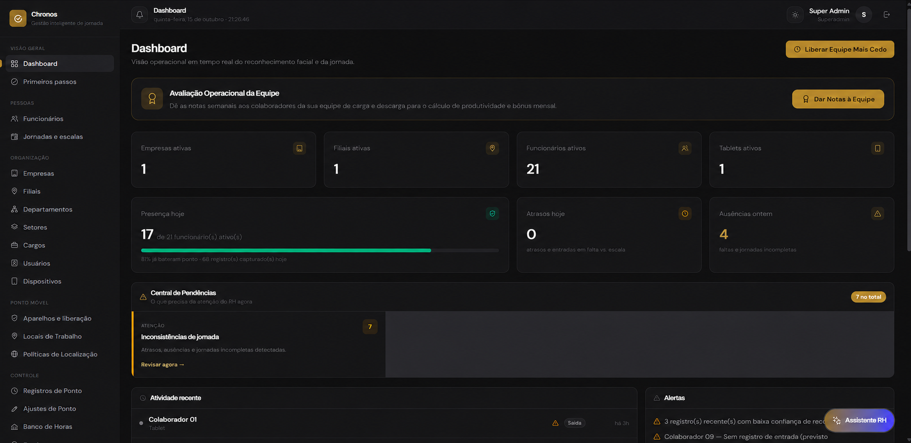
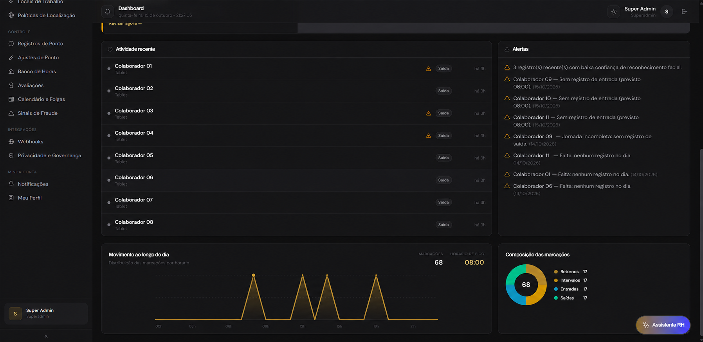
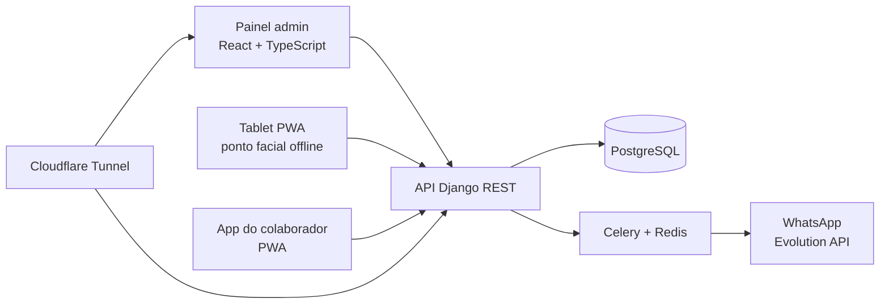

# Chronos — gestão de jornada e ponto eletrônico

Plataforma SaaS multiempresa de controle de jornada, em produção em uma empresa real. Este repositório é a **vitrine** do projeto: arquitetura, decisões e capturas de tela anonimizadas. O código-fonte é privado; posso mostrar trechos e conduzir uma revisão de código numa conversa técnica.

## O problema

Registros de ponto espalhados e ajustes manuais em planilha dificultam o controle de jornadas, escalas e banco de horas, e deixam a empresa exposta em auditorias.

## O que o sistema faz

- **Registro de ponto** por reconhecimento facial em tablet (funciona offline e sincroniza depois), pelo celular com geolocalização e pelo painel.
- **Banco de horas, espelho de ponto e justificativas**, com aprovação pelo RH e trilha de auditoria.
- **Folha de pagamento**: INSS por faixa, IRRF, vale-transporte e vale-alimentação configuráveis por empresa, contracheque em PDF.
- **Conformidade com a Portaria 671 do MTE**: geração do arquivo **AFD**.
- **Assinatura eletrônica do contracheque** com biometria facial e detecção de vivacidade.
- **Atendimento por WhatsApp**: o colaborador pede espelho e contracheque em PDF pelo bot.
- **Multiempresa**, com isolamento de dados por empresa e perfis de acesso.

## Arquitetura

Roda em servidor Linux próprio com Docker (API, worker, frontends em Nginx, PostgreSQL e Redis), exposto por Cloudflare Tunnel.

## Decisões e cuidados técnicos

- **Isolamento por empresa:** todo modelo de negócio leva a empresa; um mixin de viewset filtra e valida o escopo, com testes de isolamento entre empresas.
- **Autenticação** com JWT em cookie, perfis de acesso e limitação de tentativas de login.
- **Arquivo fiscal (AFD):** geração conforme o leiaute da Portaria 671, com testes do formato.
- **Envio em lote com cadência:** contracheques e comunicados pelo WhatsApp saem por fila (Celery) com intervalo aleatório, teto por hora e por dia e parada após falhas seguidas, para não derrubar o número.
- **IA com limites:** o bot de WhatsApp resolve o colaborador pelo telefone e foi blindado contra vazar contracheque de outra pessoa.
- **Operação:** deploy automático por webhook assinado (HMAC), CI com testes, backups diários, monitoramento de disponibilidade e **mais de 500 testes automatizados**.

## Stack

Python · Django · Django REST Framework · Celery · Redis · PostgreSQL · React · TypeScript · Vite · Tailwind CSS · PWA · Docker · Nginx · Cloudflare Tunnel · GitHub Actions

## Links

- Site do produto: <https://chronos-site-tau.vercel.app/>
- Portfólio: <https://portfolio-marcos-neto.vercel.app/>
- LinkedIn: <https://www.linkedin.com/in/marcos-neto-bbab573b6/>

## Contato

Marcos Neto — Desenvolvedor Back-end Júnior (Python/Django e Java/Spring Boot), Campina Grande-PB.
Estou buscando minha primeira vaga formal: marcos.neto0706@gmail.com
